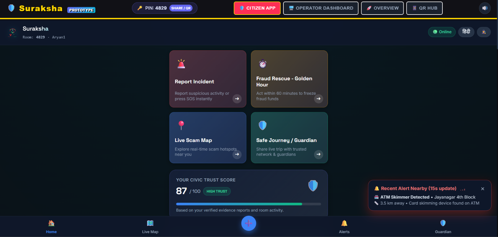
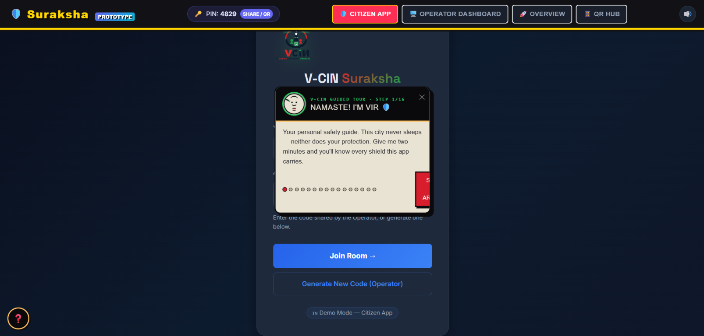
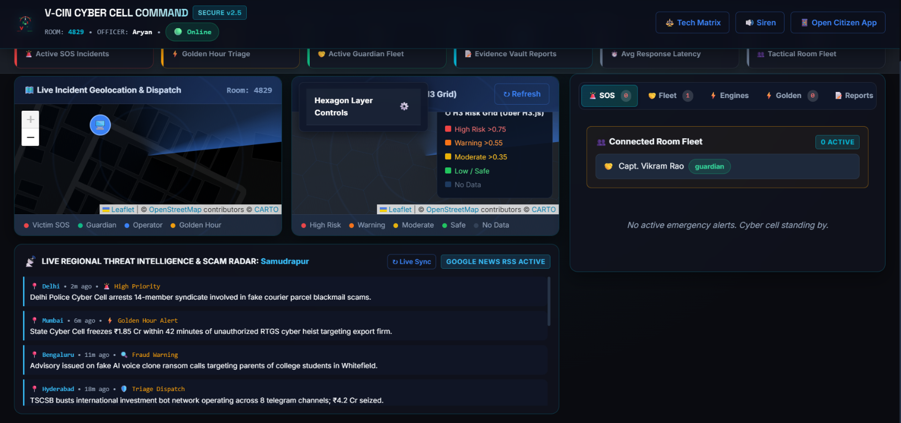
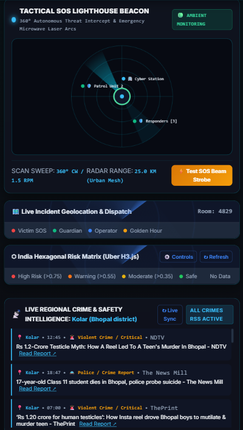

# Suraksha (Operation Moon)

Personal safety + cybercrime response PWA for the cybersecurity hackathon.

- 📄 **[PRD.md](PRD.md)** – full product requirements, honest limitations, demo script
- 🛡️ `index.html` – citizen app (SOS, journey sharing, rapid complaint, EN/HI)
- 🖥️ `operator.html` – mock cyber cell operator dashboard (receives SOS in real time)

## Pages and screenshots

- [Project overview](overview.html)
- [Citizen app](index.html)
- [Operator dashboard](operator.html)
- [QR hub](qr.html)
- [Standalone overview](overview-standalone.html)
- [CTS demo](vcin-cts-demo.html) · [Engine demo](vcin-engine-demo.html) · [IRS demo](vcin-irs-demo.html)
- [Product requirements](PRD.md)

The supplied UI screenshots are included below and in `assets/screenshots/`.

| Citizen home | Citizen onboarding |
| --- | --- |
|  |  |

| Operator dashboard | Tactical beacon |
| --- | --- |
|  |  |

## GitHub Pages

The [live site](https://oprsmoon.github.io/newagesos/) is deployed from `main` by the GitHub Actions workflow. GitHub Pages serves this as a static site; features that use the Node server, including `/api/news`, require running the app with `npm start` on a Node host.

## Run the demo

Serve the folder over HTTPS or localhost (geolocation/mic require a secure context):

```bash
npx serve .
# or
python3 -m http.server 8000
```

1. Open `index.html` in one tab (or install as PWA on your phone via "Add to Home Screen")
2. Open `operator.html` in a second tab
3. Press **SOS** – watch the alert, live coordinates, and evidence hash appear on the dashboard
4. Click **Acknowledge & Connect** on the dashboard – the victim app shows "Operator connected"

## Cross-device demo (multiple phones)

Realtime sync between devices uses a **public MQTT broker over WebSockets** (HiveMQ) – demo only, no backend needed. `BroadcastChannel` remains as same-browser fallback.

1. Open the app on 2+ phones and the operator dashboard on a laptop
2. In the **Network** card, set the **same team/family code** on every device (e.g. your team name) and enter your names
3. On guardian phones, tap **Go on Standby** (allow location + notifications)
4. On the victim phone, press **SOS** – all guardians beep/vibrate and see the alert with live distance; the operator dashboard shows it too
5. Guardians tap **I'm responding** – the victim sees who is coming; operator clicks **Acknowledge & Connect**
6. **Family live location**: start a Journey on one phone – it appears live in the Family section on the others until "I arrived"

> ⚠️ Public broker = no privacy. Anyone with your room code can see messages. Fine for a hackathon demo; production uses an authenticated WebSocket backend.
